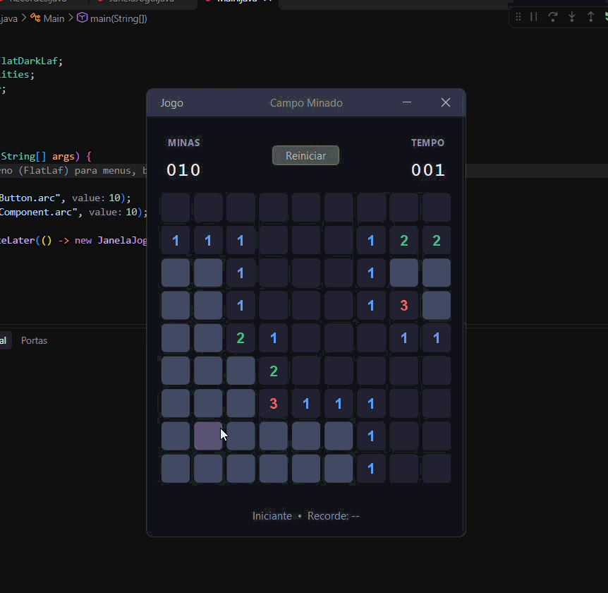
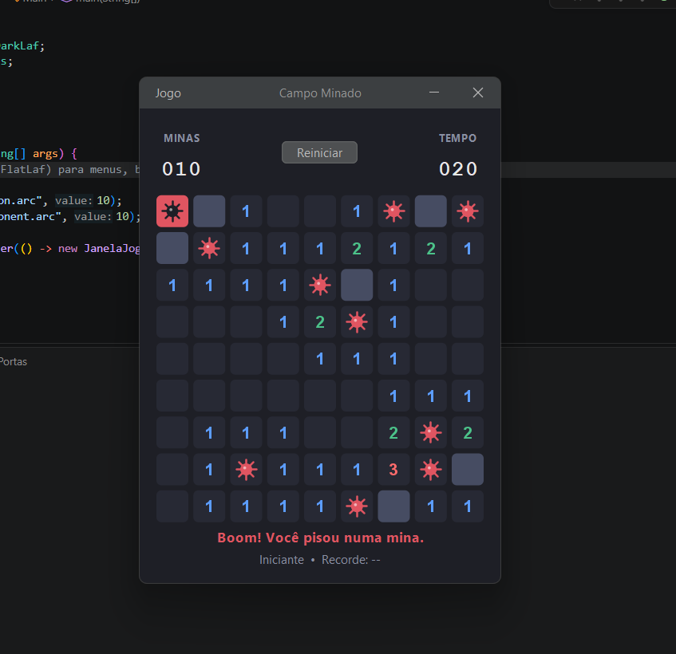

# 💣 Campo Minado em Java

Versão moderna do clássico Campo Minado, feita em **Java** com interface **Swing** e tema escuro minimalista.



## ✨ Funcionalidades

- 🎯 **3 níveis de dificuldade:** Iniciante (9x9), Intermediário (16x16) e Avançado (16x30)
- 🛡️ **Primeiro clique sempre seguro:** as minas só são sorteadas depois da primeira jogada
- 🌊 **Abertura em cascata:** casas vazias abrem automaticamente toda a região ao redor
- 🚩 **Bandeiras** para marcar as minas suspeitas
- ⏱️ **Cronômetro** e **contador de minas**
- 🏆 **Recordes salvos** para cada nível
- 🎨 **Visual moderno:** tema escuro, cantos arredondados e uma cor para cada número

## 🎮 Como jogar

| Ação | Comando |
|------|---------|
| Abrir uma casa | Clique esquerdo |
| Colocar/tirar bandeira | Clique direito |
| Novo jogo | Botão **Reiniciar** ou menu **Jogo** |
| Mudar dificuldade | Menu **Jogo** |

Cada número mostra quantas minas existem nas 8 casas ao redor. Abra todas as casas sem mina para vencer!

## 📸 Tela



## 🛠️ Tecnologias

- Java 17+
- Java Swing com desenho personalizado (`Graphics2D`)
- [FlatLaf](https://www.formdev.com/flatlaf/) para o tema escuro
- Maven

## 🧩 Estrutura do código

```
src/main/java/campominado
├── Main.java          → inicia o jogo
├── JanelaJogo.java    → janela, menu, cronômetro e status
├── BotaoCelula.java   → desenho de cada casa (números, bandeira, mina)
├── Tabuleiro.java     → regras do jogo (minas, cascata, vitória/derrota)
├── Celula.java        → estado de cada casa
├── Dificuldade.java   → níveis do jogo
├── Recordes.java      → salva o melhor tempo de cada nível
└── Tema.java          → paleta de cores
```

A lógica do jogo (`Tabuleiro`, `Celula`) é separada da interface (`JanelaJogo`, `BotaoCelula`).

## ▶️ Como executar

**Pré-requisitos:** JDK 17 ou superior e VS Code com a extensão *Extension Pack for Java*.

1. Clone o repositório:
   ```
   git clone https://github.com/heitoralves352-hub/campominadojava2023IFMG.git
   ```
2. Abra a pasta no VS Code.
3. Execute o arquivo `src/main/java/campominado/Main.java`.

## 📜 História do projeto

Este jogo começou em 2023 como um trabalho do **IFMG**, rodando apenas no terminal, com as jogadas digitadas por linha e coluna. O código original está guardado na pasta [`versao-original`](versao-original/jogo.java).

Depois ele foi reescrito com interface gráfica, código organizado em classes e várias melhorias: abertura em cascata, bandeiras, primeiro clique seguro, cronômetro e recordes.

## 👤 Autor

Desenvolvido por **Heitor Barros Alves**.